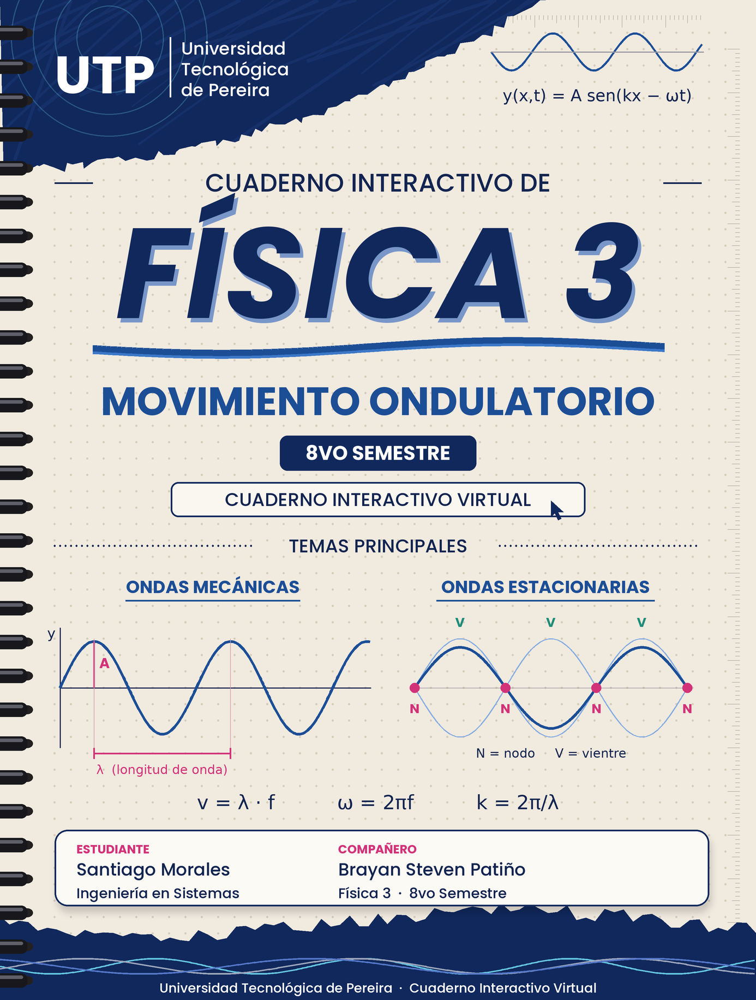

# 🌊 Cuaderno Interactivo de Física 3: Movimiento Ondulatorio y Superposición

<p align="center">
  
</p>

<p align="center">
  <strong>Proyecto didáctico e interactivo de ingeniería y física matemática para el estudio riguroso del Movimiento Ondulatorio, la Ecuación Diferencial de Onda, el Principio de Superposición, Interferencia, Batidos, Ondas Estacionarias y Simulación Dinámica estilo GeoGebra.</strong>
</p>

<p align="center">
  
  
  
  
  
  
  
</p>

---

## 📖 Tabla de Contenidos
- [Contexto Académico del Proyecto](#-contexto-académico-del-proyecto)
- [Integrantes del Proyecto](#-integrantes-del-proyecto)
- [Sobre el Proyecto](#-sobre-el-proyecto)
- [Características Principales](#-características-principales)
- [Estructura del Cuaderno (12 Páginas)](#-estructura-del-cuaderno)
- [Laboratorio Virtual & Simulador de Ondas](#-laboratorio-virtual--simulador-de-ondas)
  - [Simulación en Centímetros y Segundos con Medición de $\lambda$](#-simulación-en-centímetros-y-segundos-con-medición-de-lambda)
  - [Módulo Interactivo de Onda Armónica Simple](#-módulo-interactivo-de-onda-armónica-simple)
  - [Paleta de Estilos Gráficos (Requisito 6)](#-paleta-de-estilos-gráficos-requisito-6)
  - [Ventana Modal Ampliada (Requisito 7)](#-ventana-modal-ampliada-requisito-7)
  - [Teclado Virtual de Ecuaciones](#-teclado-virtual-de-ecuaciones)
- [Fundamentos Matemáticos & Físicos](#-fundamentos-matemáticos--físicos)
- [Tecnologías Utilizadas](#-tecnologías-utilizadas)
- [Atajos de Teclado & Navegación](#-atajos-de-teclado--navegación)
- [Instalación y Despliegue en GitHub Pages](#-instalación-y-despliegue)
- [Estructura del Repositorio](#-estructura-del-repositorio)
- [Referencias Bibliográficas](#-referencias-bibliográficas)
- [Derechos de Autor y Propiedad Intelectual](#-derechos-de-autor-y-propiedad-intelectual)

---

## 🎓 Contexto Académico del Proyecto

El presente proyecto constituye una **obra interactiva de ingeniería didáctica y desarrollo pedagógico** elaborado para la asignatura de **Física 3** en la **Universidad Tecnológica de Pereira (UTP)** (Facultad de Ingenierías).

Tras la culminación del primer volumen dedicado al *Movimiento Oscilatorio y M.A.S.*, este segundo libro virtual aborda de forma profunda y analítica el **Movimiento Ondulatorio**: la propagación espaciotemporal de perturbaciones, el estudio exhaustivo de la **Onda Armónica Simple (O.A.S.)**, la energía y potencia transmitida por ondas mecánicas, la solución analítica de la ecuación diferencial en derivadas parciales (EDP) de onda, y el trascendental **Principio de Superposición Lineal**, el cual rige fenómenos de interferencia, batidos acústicos y la formación de modos estacionarios resonantes.

---

## 👥 Integrantes del Proyecto

Este trabajo fue diseñado, programado y documentado en su totalidad por los estudiantes de la asignatura **Física 3**:

* 👨‍💻 **Santiago Morales Londoño** — *Universidad Tecnológica de Pereira (UTP)*
* 👨‍💻 **Brayan Steven Patiño** — *Universidad Tecnológica de Pereira (UTP)*

**Institución:** Universidad Tecnológica de Pereira (UTP)  
**Facultad:** Facultad de Ingenierías  
**Asignatura:** Física 3  
**Semestre Académico:** 8.º Semestre  

---

## 🔬 Sobre el Proyecto

El **Cuaderno Interactivo de Física 3: Movimiento Ondulatorio** está concebido como una Single Page Application (SPA) con diseño editorial anillado de alta categoría estética. 

Integra en una experiencia interactiva fluida:
1. **Deducciones matemáticas analíticas rigurosas** de la ecuación de onda clásica de d'Alembert y cinemática de la onda armónica simple.
2. **Protocolo pedagógico estricto de color** para la resolución de ejercicios numéricos (azul = datos, rojo = incógnitas, naranja = solución, verde = verificación dimensional y física).
3. **Simulador de ondas 2D continuo a 60 FPS**, implementado en HTML5 Canvas con soporte para pantallas Retina / 4K (`window.devicePixelRatio`).
4. **Laboratorio de Onda Armónica Simple** con doble visualización interactiva: perfil espacial instantáneo $y(x)$ con cotas y vectores de velocidad transversal $\vec{v}_y$, y registro temporal de partícula $y(t), v_y(t), a_y(t)$ con cota de período $T$.
5. **Plano cartesiano interactivo estilo "GeoGebra"** con cuadrícula mayor, menor (papel milimetrado), reglas con subdivisiones en los ejes, arrastre (pan), zoom adaptativo centrado en cursor, e inspector puntual $x$.
6. **Evaluador seguro de funciones matemáticas arbitrarias** con variables $x, t, v$, constantes $\pi, e$ y funciones trascendentes.
7. **Medición interactiva en pantalla de la longitud de onda ($\lambda$)**, distancias en centímetros ($\text{cm}$) y tiempo en segundos ($\text{s}$).

> [!NOTE]
> Todas las fórmulas matemáticas del cuaderno y del simulador están tipografiadas con **KaTeX**, garantizando un renderizado vectorial ultrarrápido y nítido de ecuaciones en derivadas parciales, integrales, matrices y notación científica.

---

## ✨ Características Principales

- 📖 **Plantilla Oficial de Cuaderno:** Fondo anillado de alta fidelidad (`Plantilla.jpg`), alineación y márgenes milimetrados calibrados sin desbordamientos horizontales.
- 📐 **Plano Cartesiano Estilo GeoGebra:**
  - Cuadrículas mayor y menor de densidad dinámica.
  - Reglas milimetradas graduadas con marcas mayores (ticks) y menores (sub-ticks).
  - Escalas autoajustables basadas en múltiplos de $1, 2, 5 \times 10^k$.
  - El cambio de escala y el zoom modifican exclusivamente la proyección visual sin alterar las constantes ni los parámetros físicos de las ondas.
- 📏 **Medición Gráfica de Longitud de Onda ($\lambda$):**
  - Detección analítica y numérica de crestas y nodos consecutivos.
  - Cota gráfica con líneas de referencia verticales discontinuas, barra horizontal con flechas bidireccionales ($\longleftrightarrow$) y badge numérico `λ = X.XX cm`.
  - Pestaña de control físico con deslizadores directos para Amplitud ($A$), Longitud de onda ($\lambda$), Frecuencia ($f$), Período ($T$), Velocidad ($v$), Número de onda ($k$) y Frecuencia angular ($\omega$).
- 🌊 **Estudio Completo de Onda Armónica Simple (Pág. 5):**
  - Formulación canónica y 5 formas equivalentes.
  - Análisis cinemático de partículas: elongación $y$, velocidad $v_y = \partial y/\partial t$, aceleración $a_y = -\omega^2 y$ (M.A.S.).
  - Distinción física entre velocidad de onda $v$ y velocidad de partícula $v_y$.
  - Vectores de velocidad transversal $\vec{v}_y$ renderizados dinámicamente en pantalla.
  - Registro temporal $y(t), v_y(t), a_y(t)$ con cota de período $T$ y visualización de desfases ($0, \pi/2, \pi$).
  - Densidad de energía $\langle u \rangle$ y potencia media transmitida $\bar{P} \propto A^2 f^2$.
- 🎨 **Paleta de Estilos Integral (Requisito 6):**
  - Temas globales: **Claro** y **Oscuro** con óptimo contraste.
  - Selector de color de fondo del gráfico.
  - Colores y grosores configurables para ejes $X$ e $Y$.
  - Personalización de cuadrícula mayor y menor (color y grosor).
  - Tamaño de etiquetas y números del plano (8 px a 18 px).
  - Estilos individuales por componente: color, grosor (0.5 a 8 px), opacidad y patrones de línea (continua, guiones, puntos, guión-punto).
  - Estilo completamente independiente para la onda resultante $\sum y_i(x,t)$.
- 🖥️ **Ventana Modal Ampliada a Pantalla Completa (Requisito 7):**
  - Botón de ampliación dedicado que despliega el laboratorio a resolución maximizada.
  - **Sincronización en tiempo real:** Ambas vistas comparten el mismo estado temporal $t$, ecuaciones y parámetros sin animaciones duplicadas ni desfases.
  - Controles completos replicados en el modal (reproducción, velocidad, zoom, inspector, visualización de $\lambda$).
  - Atajo rápido para cerrar con tecla <kbd>Escape</kbd>.
- ⌨️ **Teclado Virtual de Ecuaciones de Ondas:**
  - Modal táctil para escribir ecuaciones de ondas de forma intuitiva sin errores de sintaxis.
  - Botones dedicados para funciones trigonométricas ($\sin, \cos$), variables ($x, t, v$), operadores, exponentes, fracciones y la constante $\pi$.
  - Validación sintáctica en vivo antes de agregar la onda.
- 🧪 **Banco de Experimentos & Presets:**
  - *Onda Armónica Progresiva en cm y s con $\lambda$ medible*.
  - *Pulsos iguales viajando en sentidos opuestos*.
  - *Pulsos de signos contrarios (aniquilación temporal)*.
  - *Pulsos con distintas amplitudes y anchuras*.
  - *Superposición de tres componentes sinusoidales*.
  - *Dos ondas con diferencia de fase $\Delta\varphi$*.
  - *Onda estacionaria con nodos fijos y antinodos*.
  - *Batidos acústicos por proximidad frecuencial*.
- 💾 **Exportación e Importación:** Guardado y carga de configuraciones completas de ondas en formato JSON y captura de imagen en formato PNG de alta resolución.

---

## 📑 Estructura del Cuaderno

El cuaderno interactivo consta de una portada oficial y 11 páginas de contenido riguroso (12 vistas en total):

| Pág. | Módulo Temático | Descripción y Recursos Clave |
| :---: | :--- | :--- |
| **0** | **Portada Oficial UTP** | Portada institucional con botón de apertura interactivo. |
| **1** | **Índice General y Presentación** | Guía de navegación, convenciones pedagógicas y justificación didáctica del curso. |
| **2** | **Mapa Mental Conceptual** | Red conceptual interactiva: tipos de ondas, parámetros cinemáticos, onda armónica, ecuación diferencial y superposición. |
| **3** | **Línea de Tiempo Histórica** | Hitos cronológicos: Huygens (1678), Euler (1744), d'Alembert (1747), Fourier (1822), Maxwell (1865) y Hertz (1888). |
| **4** | **Conceptos y Definiciones Fundamentales** | Perturbación, amplitud $A$, longitud de onda $\lambda$, período $T$, frecuencia $f$, número de onda $k$, frecuencia angular $\omega$ y velocidad de fase $v$. |
| **5** | **Onda Armónica Simple (O.A.S.)** | Doble periodicidad espaciotemporal, 5 formas analíticas equivalentes, cinemática de partículas $v_y, a_y$, dos gráficas interactivas GeoGebra ($y(x)$ con vectores $\vec{v}_y$ y registro temporal $y(t)$), transporte de energía y potencia media $\bar{P}$. |
| **6** | **Ecuación Diferencial de Onda** | Deducción matemática completa a partir de la 2ª Ley de Newton en cuerda tensa: $\frac{\partial^2 y}{\partial t^2} = \left(\frac{T_s}{\mu}\right) \frac{\partial^2 y}{\partial x^2}$. Solución general d'Alembertiana. |
| **7** | **Principio de Superposición & Interferencia** | Linealidad del operador diferencial de onda, interferencia constructiva y destructiva, batidos y formulación de ondas estacionarias. |
| **8** | **Laboratorio Virtual Interactivo** | Simulador GeoGebra con panel de ondas, controles en cm y s, medidor de $\lambda$, teclado virtual, paleta de estilos y ventana modal ampliada. |
| **9** | **Ejercicios Resueltos con Protocolo de Color** | Problemas típicos de examen (velocidad, superposición con desfase y cinemática completa de onda armónica) desglosados en: azul (datos), rojo (incógnitas), naranja (resolución analítica) y verde (validación). |
| **10** | **Glosario Científico Ilustrado** | Diccionario científico con buscador en vivo, símbolos, definiciones formales y unidades del Sistema Internacional (SI). |
| **11** | **Referencias Bibliográficas** | Fuentes bibliográficas canónicas universitarias citadas bajo la norma internacional **APA 7.ª edición**. |

---

## 🧪 Laboratorio Virtual & Simulador de Ondas

El simulador se compone de módulos desacoplados y modulares en JavaScript puro:

```
js/
├── harmonic-wave.js # Módulo interactivo de Onda Armónica Simple (canvases espacial y temporal, vectores vy)
├── wave-engine.js   # Motor físico y matemático (evaluación segura, superposición, presets, JSON)
├── wave-canvas.js   # Renderizador cartesiano GeoGebra HiDPI (ejes, cuadrícula, cotas de λ, inspector)
└── wave-ui.js       # Controlador de interfaz de usuario (eventos, panel, teclado virtual, modal, paleta)
```
├── wave-engine.js   # Motor físico y matemático (evaluación segura, superposición, presets, JSON)
├── wave-canvas.js   # Renderizador cartesiano GeoGebra HiDPI (ejes, cuadrícula, cotas de λ, inspector)
└── wave-ui.js       # Controlador de interfaz de usuario (eventos, panel, teclado virtual, modal, paleta)
```

### 📏 Simulación en Centímetros y Segundos con Medición de $\lambda$
Diseñado para responder al requerimiento explícito del docente:
* **Unidades físicas:** Ejes cartesianos calibrados en centímetros ($x\text{ [cm]}$, $y\text{ [cm]}$) y tiempo en segundos ($t\text{ [s]}$).
* **Medición visual directa:** El botón `[📏 Ver λ]` traza de forma continua una cota sobre dos crestas visibles adyacentes, con flechas de dimensión y valor numérico exacto en tiempo real.
* **Pestaña interactiva de Parámetros:**
  $$\eqalign{
    & v = \lambda \cdot f = \frac{\omega}{k} \quad [\text{cm/s}] \cr
    & k = \frac{2\pi}{\lambda} \quad [\text{rad/cm}] \cr
    & \omega = 2\pi f = \frac{2\pi}{T} \quad [\text{rad/s}] \cr
  }$$

### 🎨 Paleta de Estilos Gráficos (Requisito 6)
Al pulsar el botón con icono de paleta, se despliega un panel lateral donde se configura:
* Fondo general del plano cartesiano.
* Color y grosor de los ejes de coordenadas.
* Cuadrícula mayor y menor (estilo papel milimetrado).
* Tamaño de la tipografía de numeración y etiquetas.
* Color, grosor, opacidad y patrón de trazo (*Línea continua*, *Trazos*, *Punteada*, *Trazo-punto*) de cada onda individual.
* Estilo independiente de la onda resultante.
* Vector de velocidad de propagación de fase $\vec{v}$.

### 🔍 Ventana Modal Ampliada (Requisito 7)
* Ampliación a pantalla casi completa con un solo clic en **"Ampliar"**.
* Mantiene sincrónicos el tiempo $t$, la velocidad de reproducción, las ondas activadas y los estilos.
* Atajo de teclado: pulsar <kbd>Escape</kbd> cierra el modal inmediatamente.

### ⌨️ Teclado Virtual de Ecuaciones
* Permite crear y editar ondas con expresiones como:
  $$y(x,t) = 2 \cdot \sen(x - 3 \cdot t)$$
  $$y(x,t) = \frac{2}{(x - 3 \cdot t)^4 + 1}$$
* Inserción asistida de operadores, potencias (`**`), funciones y constantes.

---

## 📐 Fundamentos Matemáticos & Físicos

### 1. Ecuación Clásica de Onda en una Dimensión
$$\frac{\partial^2 y}{\partial t^2} = v^2 \frac{\partial^2 y}{\partial x^2}$$
Donde la velocidad de propagación $v$ para una cuerda sometida a tensión $T_s$ con densidad lineal de masa $\mu$ es:
$$v = \sqrt{\frac{T_s}{\mu}}$$

### 2. Onda Armónica Simple (O.A.S.)
Formulación canónica y formas equivalentes:
$$y(x,t) = A \cdot \sen(kx \mp \omega t + \phi_0) = A \cdot \sen\left[2\pi\left(\frac{x}{\lambda} \mp \frac{t}{T}\right) + \phi_0\right] = A \cdot \sen\left[k(x \mp vt) + \phi_0\right]$$
* **Criterio de propagación:** Signo $(-)$ indica viaje hacia $+x$ (derecha); signo $(+)$ indica viaje hacia $-x$ (izquierda).
* **Velocidad transversal de partícula (M.A.S.):**
  $$v_y(x,t) = \frac{\partial y}{\partial t} = \mp \omega A \cos(kx \mp \omega t + \phi_0), \qquad v_{y,\text{máx}} = \omega A$$
* **Aceleración transversal de partícula:**
  $$a_y(x,t) = \frac{\partial^2 y}{\partial t^2} = -\omega^2 y(x,t), \qquad a_{y,\text{máx}} = \omega^2 A$$
* **Relación cinemática con la pendiente espacial:**
  $$v_y(x,t) = -v \cdot \frac{\partial y}{\partial x}$$
* **Densidad de energía media y potencia promedio:**
  $$\langle u \rangle = \frac{1}{2}\mu\omega^2 A^2 \quad [\text{J/m}], \qquad \bar{P} = \frac{1}{2}\mu v \omega^2 A^2 = 2\pi^2\mu v f^2 A^2 \quad [\text{W}]$$

### 3. Principio de Superposición Lineal
Si $y_1(x,t), y_2(x,t), \dots, y_n(x,t)$ son soluciones de la ecuación lineal de onda, su suma también es solución:
$$y_R(x,t) = \sum_{i=1}^{n} y_i(x,t)$$

### 4. Batidos (Pulsaciones)
Superposición de dos ondas armónicas con frecuencias muy próximas ($\omega_1 \approx \omega_2$):
$$y_R(x,t) = \left[ 2A \cos\left( \frac{\Delta k}{2} x - \frac{\Delta\omega}{2} t \right) \right] \cdot \sen\left( \bar{k}x - \bar{\omega}t \right)$$
Frecuencia de batido:
$$f_{bat} = |f_1 - f_2|$$

### 5. Ondas Estacionarias
Superposición de dos ondas armónicas idénticas en sentidos opuestos:
$$y_R(x,t) = \left[ 2A \sen(kx) \right] \cdot \cos(\omega t)$$
* **Nodos:** $kx = n\pi \implies x = n \frac{\lambda}{2} \quad (n = 0, 1, 2, \dots)$
* **Antinodos:** $kx = \left(n + \frac{1}{2}\right)\pi \implies x = \left(n + \frac{1}{2}\right)\frac{\lambda}{2}$

---

## 💻 Tecnologías Utilizadas

- **Frontend Core:** HTML5 Semántico y CSS3 Vanilla (Custom Properties, Flexbox, CSS Grid, Glassmorphism).
- **Lógica & Gráficos:** JavaScript ES6+ modular, Canvas 2D API optimizada para pantallas HiDPI (`devicePixelRatio`).
- **Renderizado Matemático:** [KaTeX](https://katex.org/) v0.16.9 con auto-render para fórmulas vectoriales LaTeX.
- **Tipografías:** *Outfit* (títulos e interfaz), *Lora* (textos editoriales) y *Fira Code* (código y números de ejes) de Google Fonts.
- **Iconografía:** [Font Awesome 6](https://fontawesome.com/) y vectores SVG nativos.

---

## ⌨️ Atajos de Teclado & Navegación

| Tecla | Acción |
| :---: | :--- |
| <kbd>→</kbd> / <kbd>Av Pág</kbd> | Avanzar a la página siguiente del cuaderno |
| <kbd>←</kbd> / <kbd>Re Pág</kbd> | Retroceder a la página anterior |
| <kbd>Inicio</kbd> / <kbd>Home</kbd> | Regresar a la Portada (Página 0) |
| <kbd>Fin</kbd> / <kbd>End</kbd> | Ir a las Referencias Bibliográficas (Página 10) |
| <kbd>Esc</kbd> | Cerrar menú de índice (TOC), teclado virtual o ventana modal ampliada |

---

## 🚀 Instalación y Despliegue

### 1. Clonar o descargar el repositorio
```bash
git clone https://github.com/TU_USUARIO/fisica-3-movimiento-ondulatorio.git
cd fisica-3-movimiento-ondulatorio
```

### 2. Ejecutar localmente
No requiere paquetes Node.js ni compiladores:
* **Abrir directamente:** Haz doble clic sobre el archivo `index.html`.
* **Con VS Code:** Clic derecho sobre `index.html` $\rightarrow$ *"Open with Live Server"*.
* **Con Python:**
  ```bash
  python -m http.server 8000
  ```
  Accede a `http://localhost:8000` en tu navegador.

### 3. Publicación en GitHub Pages 🌐
1. Sube tu proyecto a un repositorio en GitHub.
2. Ve a **Settings** $\rightarrow$ **Pages**.
3. En la sección **Branch**, selecciona `main` (o `master`) y la carpeta `/ (root)`.
4. Guarda los cambios. En 1-2 minutos tu cuaderno estará publicado en línea.

---

## 📁 Estructura del Repositorio

```text
Movimiento Ondulatorio/
├── css/
│   ├── notebook.css          # Estructura del cuaderno, diseño de páginas, TOC y navegación
│   └── wave-simulator.css    # Estilos del simulador, barra de herramientas, paleta y modal
├── Imagenes/
│   ├── Plantilla.jpg         # Fondo oficial del cuaderno con espiral y marco milimetrado
│   └── portada_fisica3_ondas_cuaderno.png # Portada oficial institucional
├── js/
│   ├── wave-engine.js        # Motor matemático de ondas (evaluador, superposición, presets)
│   ├── wave-canvas.js        # Motor del plano cartesiano GeoGebra HiDPI (ejes, cuadrícula, cota λ)
│   └── wave-ui.js            # Controlador de la interfaz (panel de ondas, teclado virtual, modal)
├── index.html                # Documento principal SPA con las 11 páginas integradas
└── README.md                 # Documentación técnica, pedagógica y académica del proyecto
```

---

## 📚 Referencias Bibliográficas

Marco teórico y ejercicios contrastados con la literatura canónica de física universitaria (norma APA 7.ª edición):

- **French, A. P. (1971).** *Vibrations and waves* (M.I.T. Introductory Physics Series). W. W. Norton & Company.
- **Halliday, D., Resnick, R., & Walker, J. (2014).** *Fundamentals of physics* (10th ed., Vol. 1). John Wiley & Sons.
- **Pain, H. J. (2005).** *The physics of vibrations and waves* (6th ed.). John Wiley & Sons.
- **Serway, R. A., & Jewett, J. W. (2018).** *Física para ciencias e ingeniería* (10.ª ed., Vol. 1). Cengage Learning.
- **Tipler, P. A., & Mosca, G. (2010).** *Física para la ciencia y la tecnología: Mecánica, oscilaciones y ondas, termodinámica* (6.ª ed., Vol. 1). Editorial Reverté.
- **Young, H. D., & Freedman, R. A. (2018).** *Sears y Zemansky: Física universitaria con física moderna* (14.ª ed., Vol. 1). Pearson Educación.

---

## ⚖️ Derechos de Autor y Propiedad Intelectual

> **© 2024–2026 Santiago Morales Londoño y Brayan Steven Patiño.**  
> **Universidad Tecnológica de Pereira (UTP) — Facultad de Ingenierías.**  
> **Asignatura: Física 3.**

Todos los derechos intelectuales sobre el diseño pedagógico, los textos, el código fuente de los motores de simulación (`wave-engine.js`, `wave-canvas.js`, `wave-ui.js`) y la arquitectura de la aplicación pertenecen a sus respectivos autores: **Santiago Morales Londoño** y **Brayan Steven Patiño**.

### Condiciones de Uso y Atribución Académica:
1. **Uso Educativo:** Se autoriza la consulta y uso libre con propósitos estrictamente académicos, pedagógicos y de divulgación científica.
2. **Atribución Obligatoria:** Cualquier cita, adaptación o derivación de este proyecto debe citar formalmente a los autores y a la Universidad Tecnológica de Pereira (UTP).
3. **Prohibición de Plagio:** Queda terminantemente prohibida la copia no autorizada, redistribución o presentación parcial o total de esta obra como si fuera de autoría ajena.
4. **Uso No Comercial:** Este recurso no puede ser comercializado ni integrado en plataformas con fines de lucro sin autorización expresa por escrito de los autores.
